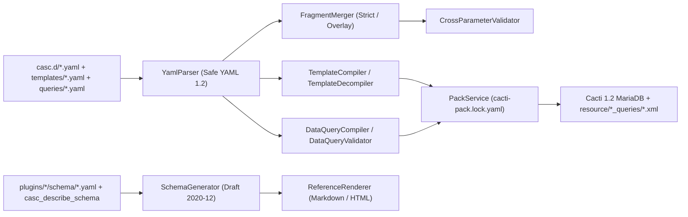

# plugin_yaml

`plugin_yaml` is a standalone Cacti 1.2 plugin providing a hardened pure-PHP YAML 1.2 engine, JCasC-style multi-file fragment merging, lossless bidirectional `YAML <-> Native Cacti XML` template and Data Query compilers, live JSON Schema (Draft 2020-12) generation, cross-parameter invariant validation, and versioned Monitoring Packs.

## Why this plugin exists

Cacti 1.2 stores templates and Data Queries as verbose XML documents with opaque 32-hex hash cross-references (`<hash_000103...>`). Reviewing template changes in Git, composing multi-file configuration directories (`casc.d/*.yaml`), and catching inter-parameter misconfigurations before import are error-prone with raw XML alone.

`plugin_yaml` runs with zero runtime Composer dependencies and zero hard imports of companion plugins. It works standalone on Cacti 1.2.31+ and integrates with `plugin_casc`, `plugin_doctor`, `plugin_mcp`, and `plugin_api` through plain-array hook descriptors and static `schema/*.yaml` files when those plugins are installed.

## Architecture



## Capabilities

### 1. Hardened Pure-PHP YAML 1.2 Safe Engine (`lib/Codec/`)
- Parses the YAML 1.2 safe subset (mappings, sequences, flow collections, literal and folded block scalars, quoted escapes, comments, anchors, aliases, merge key `<<`, and core YAML 1.2 tags `!!str`, `!!int`, `!!float`, `!!bool`, `!!null`, `!!seq`, `!!map`).
- Rejects executable and object tags (`!php/object`, `!!php/...`, custom `!tags`, `%TAG` directives).
- Enforces bounded limits: 4 MiB input size (`MAX_BYTES`), nesting depth 32 (`MAX_DEPTH`), 50,000 mapping keys (`MAX_KEYS`), and an alias expansion ratio ceiling (`MAX_ALIAS_EXPANSION_RATIO = 10`, `MAX_TOTAL_NODES = 100000`) to stop billion-laughs expansion payloads.
- Emits deterministic canonical YAML 1.2 via `YamlEmitter`.

### 2. JCasC-Style Multi-File Fragment Merger (`lib/Merge/`)
- Discovers and merges single files, comma-separated lists, or `casc.d/*.yaml` directories in deterministic lexical order.
- Refuses symlinks and parent-directory traversal (`PathGuard`).
- Deep-merges mappings and supports `replace`, `append`, and `mergeByKey` list modes (matching natural keys `hostname`, `slug`, `name`, `path`, `outputFile`, `id`).
- Enforces `strict` scalar conflict rejection by default or explicit `overlay` override.
- Validates and redacts `${ENV_VAR}`, `${ENV_VAR:-default}`, `${file:/abs/path}`, and `vault:path#key` placeholders so secret material never appears in Console views, CLI outputs, or audit logs.

### 3. Cross-Parameter Invariant Validation (`lib/Validation/CrossParameterValidator.php`)
Single-field schema type checks miss contradictions between related parameters. Grounded in empirical findings by Yin et al. (ACM SOSP 2011, "An Empirical Study on Configuration Errors in Commercial and Open Source Systems"), `CrossParameterValidator` checks inter-parameter constraints across Cacti configurations:
- **SNMP security consistency:** requires community strings on SNMPv1/v2 (and forbids SNMPv3 credentials there); on SNMPv3, requires `username`, enforces `authPassword` when `authProtocol != [None]`, forbids `privProtocol` without authentication (`noAuthPriv`), requires `privPassphrase` when privacy is enabled, and forbids v1/v2 community strings.
- **Poller and cron alignment:** verifies `poller_interval` and `cron_interval` are positive and `poller_interval` divides `cron_interval` evenly.
- **Referential consistency:** checks device and graph tree references against declared sites, pollers, templates, and hosts.
- **Data Query bindings:** ensures every `indexOrder` field exists and has direction `input` or `input-output`, prevents mixing SNMP `oid` and script `queryName` properties, and checks `oidIndexParse` / `outputDelimiter` dependencies.
- **Template and Pack invariants:** catches duplicate or dangling `ref:<type>/<slug>` links in `CactiTemplateBundle` manifests and empty or incompatible `MonitoringPack` definitions.

### 4. Lossless Bidirectional `YAML <-> Native Cacti XML` Compiler (`lib/Template/`)
- Decompiles native Cacti `<cacti><hash_...>` XML (Host, Graph, Data, and Data Query templates plus dependent CDEFs, GPRINT presets, VDEFs, Data Input Methods, RRAs, and Data Source Profiles) into readable symbolic YAML (`CactiTemplateBundle`).
- Compiles symbolic YAML back into canonical `<cacti>` XML with deterministic hash preservation (`cactiHash`) or FIPS-safe SHA-256 deterministic 32-hex derivation (`HashRegistry::deriveHash()`).
- Rejects `<!DOCTYPE` and `<!ENTITY` declarations to block XXE payloads.

### 5. SNMP and Script Data Query Compiler (`lib/Query/`)
- Authors `resource/snmp_queries/*.xml` (`SnmpDataQuery`) and `resource/script_queries/*.xml` (`ScriptDataQuery`) in YAML and decompiles existing Cacti `<interface>` XML files back to YAML.
- Validates dotted numeric OIDs, `VALUE/REGEXP:` and `OID/REGEXP:` expressions, methods (`walk`, `get`), directions (`input`, `output`, `input-output`), index order references, and output path allowlisting (`resource/snmp_queries/`, `resource/script_queries/`, `resource/script_server/`).

### 6. Live JSON Schema (Draft 2020-12) and Reference Docs (`lib/Schema/`, `schema/yaml.schema.yaml`)
- Ships a static Drupal-style `schema/yaml.schema.yaml` descriptor separating declarative `config` keys from read-only runtime `state` keys.
- Discovers `plugins/*/schema/*.yaml` across installed plugins without executing plugin code and merges optional dynamic `casc_describe_schema` hook arrays.
- Emits Draft 2020-12 JSON Schema (`cacti-casc.schema.json`) and Markdown/HTML Reference Documentation.

### 7. Versioned Monitoring Packs (`lib/Pack/`)
- Exports, validates, plans, and applies versioned `MonitoringPack` manifests bundling templates, Data Queries, and CasC fragments.
- Generates and verifies `cacti-pack.lock.yaml` SHA-256 lockfiles and requires an explicit `--confirm=<PLAN_HASH>` confirmation gate on apply.

### 8. Console UI (3-Tier RBAC) and CLI (`cli/yaml.php`)
- **View (`yaml_view.php`):** redacted YAML state preview, `cacti-casc.schema.json` download, live Schema Reference, installed packs, and audit history.
- **Operator (`yaml_operator.php`):** YAML validation, secret-redacted preview, and dry-run XML compilation.
- **Admin (`yaml_admin.php`):** two-step reload plan and session-bound confirmation apply with CSRF protection.
- Realms enforce strict inheritance (`YAML Admin > YAML Operator > YAML View`).

### 9. Decoupled Ecosystem Hooks (`lib/Integration/`)
- `casc_register_providers` (`slug: yaml`), `casc_register_template_compilers` (`.yaml`/`.yml`), `casc_describe_schema`
- `doctor_register_checks` (source permissions, fragment validation, compiled Data Query XML checksum drift)
- `abilities_register` (read-only View-realm abilities: `yaml-get-schema`, `yaml-list-packs`, `yaml-validate-source`)
- `api_register_resources` (plain-array `yamlPacks` and `yamlSchema` descriptors)

## CLI usage

```bash
# Generate live JSON Schema Draft 2020-12 and Reference Markdown
php plugins/yaml/cli/yaml.php schema --out=/tmp/cacti-casc.schema.json
php plugins/yaml/cli/yaml.php schema --reference=markdown --out=/tmp/reference.md

# Decompile a native Cacti Data Query or template XML to YAML and compile it back
php plugins/yaml/cli/yaml.php decompile --in=resource/snmp_queries/interface.xml --out=/tmp/interface.yaml --name=resource/snmp_queries/interface.xml
php plugins/yaml/cli/yaml.php compile --in=/tmp/interface.yaml --out=/tmp/interface-compiled.xml

# Merge, validate, dry-run, and apply casc.d/ fragments
php plugins/yaml/cli/yaml.php merge --source=/etc/cacti/casc.d --policy=strict
php plugins/yaml/cli/yaml.php validate --source=/etc/cacti/casc.d
php plugins/yaml/cli/yaml.php reload --source=/etc/cacti/casc.d --dry-run
php plugins/yaml/cli/yaml.php reload --source=/etc/cacti/casc.d --confirm=<PLAN_HASH>

# Manage versioned Monitoring Packs
php plugins/yaml/cli/yaml.php pack-export --dir=/opt/packs/linux --name=linux-base --version=1.0.0 --out=/opt/packs/linux/pack.yaml
php plugins/yaml/cli/yaml.php pack-validate --manifest=/opt/packs/linux/pack.yaml --require-lock
php plugins/yaml/cli/yaml.php pack-plan --manifest=/opt/packs/linux/pack.yaml
php plugins/yaml/cli/yaml.php pack-apply --manifest=/opt/packs/linux/pack.yaml --confirm=<PLAN_HASH>
```

## Requirements and compatibility

- **Cacti:** 1.2.31+ (tested in CI against `release/1.2.31` and `1.2.x` on MariaDB 11.8)
- **PHP:** 8.2+ runtime (`setup.php`, Console pages, `include/autoload.php`, and `cli/yaml.php` remain PHP 8.0 parseable to refuse older runtimes cleanly)
- **PHP extensions:** `dom`, `json`, `libxml`, `mbstring`, `pdo`, `pdo_mysql`
- **Runtime Composer dependencies:** none

## Development and quality gates

```bash
composer install
vendor/bin/phpunit -c phpunit.xml
CACTI_PATH=/path/to/cacti vendor/bin/phpstan analyse -c phpstan.neon --memory-limit=1G --no-progress
```

CI enforces:
1. PHP 8.0 syntax lint on all entry points (`*.php`, `include/*.php`, `cli/*.php`).
2. PHP 8.2 through 8.5 unit, adversarial security, and cross-parameter invariant tests.
3. 100% PHPDoc coverage across `lib/` and `setup.php` (`tests/Quality/PhpDocCoverageTest.php`).
4. Measured `pcov` line coverage >= 85% (`clover.xml`).
5. PHPStan Level 9 with zero errors against Cacti 1.2.31 stubs.
6. Live MariaDB 11.8 integration tests and CLI smoke tests on Cacti `release/1.2.31` and `1.2.x`.

## License

GPL-2.0-or-later. See [LICENSE](LICENSE) and [REUSE.toml](REUSE.toml).
